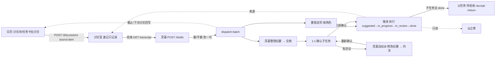

# 推进链路原型 · advance-flow-prototype

把 **日历 / 讨论（会议室）/ 速记 / 推进（ai-advance）/ 灵基** 串成一条可点击的端到端链路。Vite + React + TypeScript 纯静态 SPA，数据全部 mock 在内存 + localStorage，灵基输出为脚本。当前用户 刘洋，今天 2026-11-03。

```bash
npm i && npm run dev      # 本地
npm run build             # 产物在 dist/
npm run smoke             # Playwright 冒烟，截图到 shots/
```
Vercel：导入仓库即可（`vercel.json` 已配 SPA rewrite，输出 `dist`）。

## 怎么玩
- 右上角切角色：刘洋（发起人）/ 老王 / 阿炜 / 张三（负责人）。
- 「▶ 自动演示」一步步走完整条链；「一键重置」回到初始；「撤销」或 toast 里撤销上一步。
- 右侧「链路」面板：当前第几步 + 本步用到的接口/数据（绿色=现有，橙色=新增）+ 调用记录。

## 链路
1. **日历**：周视图里讨论块「门店巡检改版对齐」绑定任务；任务卡「拉个讨论」（来源 `item:<advanceId>`）；「发起讨论」不绑任务。
2. **讨论室**：「速记记录中 · 只记录」条，转写逐行出现，灵基只计数（`meeting:<userId>:<stenoId>`）。
3. **结束**：灵基读速记 → `POST /drafts` → 任务集 + 4 件子任务草稿（带原话、预填负责人）；开关「整理正式纪要」加一件「整理纪要并收齐确认」；逐条要/不要、改一句 → `dispatch-batch`。
4. **要我定的**（按角色）：派给我 / 到期 / 没人接 / 灵基回话 / 灵基交稿 / 待确认 / 待验收 / 没人动·催一下；一句话 + 直接操作，处理完即消失，可撤销。
5. **推进执行**：suggested → in_progress → in_review → done；灵基只能提交验收，人来流转。
6. **正式纪要**：灵基交稿 → 发给老王、阿炜确认 → 1:1 确认子任务；确认无误 = done；有异议 = 评论 → 灵基自动给刘洋派「修改纪要」→ 改好后重新发给提异议的人。
7. **收口**：子任务全部 done → 父任务 in_review → 刘洋待验收 → `/accept` 或 `/return`。
8. **回流**：截止日和下次讨论写回日历；任意「来源」跳回速记原文并高亮原话；「云之家只读」看同一份数据。



## 现有 vs 新增
| 能力 | 状态 |
|---|---|
| 速记 `meeting:<userId>:<stenoId>`、转写读取 | 现有 |
| `dispatch-batch`、任务状态流转、评论、`/accept` `/return`、催一下 | 现有 |
| 灵基提交验收、云之家只读 | 现有 |
| **日历绑任务** | 新增 |
| **任务卡拉讨论**（source `item:<advanceId>`） | 新增 |
| **灵基从速记起草**（`POST /drafts`） | 新增 |
| **纪要 1:1 确认 + 异议自动派修改单** | 新增 |
| **截止回写日历 + 来源跳原话** | 新增 |

## 结构
`src/store.ts` 数据模型、reducer、要我定的规则；`src/App.tsx` 各视图 + 链路面板 + 自动演示；`src/style.css` 沿用 super-entry-ref 的 lgwk 配色（主蓝只给可点的，灵基紫只给灵基）。
